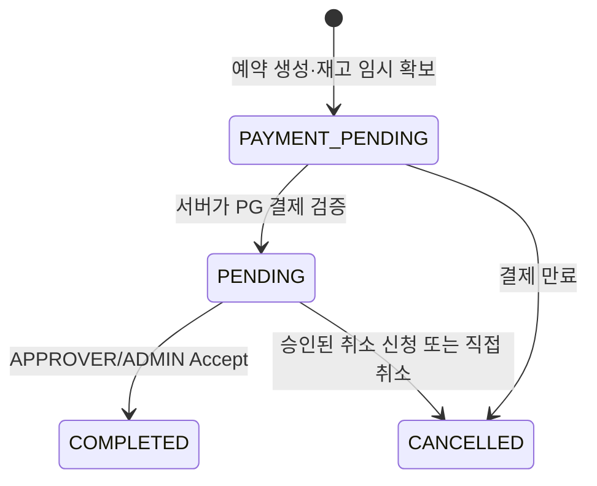
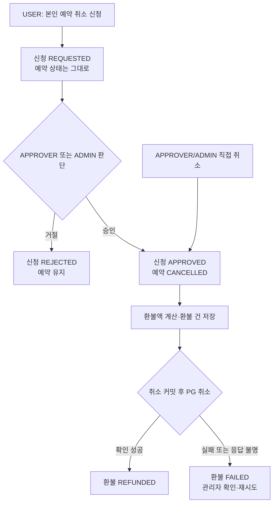

# 예약·결제·취소 흐름

[← 가이드 홈](README.md) · [DB 스키마](DATABASE.md) · [Spring Boot 구조](SPRING_BOOT.md)

## 예약 상태

| 상태 | 의미 | 재고 점유 |
|---|---|---|
| `PAYMENT_PENDING` | 결제 전. `payment_expires_at`까지 임시 점유 | 만료 전만 |
| `PENDING` | 결제 완료, 승인 대기 | 예 |
| `COMPLETED` | 승인자가 승인해 **예약 절차 완료**. 숙박 이용 완료는 아님 | 예약 기간 동안 예 |
| `CANCELLED` | 결제 만료 또는 실제 취소 처리 | 아니요 |

`ACCEPT`는 결제가 `PAID`인 `PENDING`에만 허용하며 즉시 `COMPLETED`로 바꿉니다. 이는 **예약 완료**를 뜻합니다. 숙박 **이용 완료** 상태와 처리는 추후 설계합니다. `COMPLETED` 예약도 취소 정책에 맞으면 `CANCELLED`로 전환할 수 있습니다.

## 동일 유형 객실의 재고

`rooms.total_quantity = 3`이면 같은 유형 객실을 같은 숙박일에 최대 3건 판매할 수 있습니다. 예약 시 `rooms` 행을 잠그고 요청 숙박일 **하루하루**의 유효 예약 수를 세어 모두 3 미만일 때 저장합니다. 단순히 전체 요청 기간과 겹치는 예약 수를 한 번만 세면 날짜별 점유가 달라 정상 예약을 거절할 수 있습니다. 체크아웃 날짜는 점유일에 포함하지 않습니다. 결제 만료 처리와 PG 성공 콜백도 예약 행 잠금과 상태 검증으로 경합을 제어합니다.

## 취소 신청과 직접 취소

- 사용자는 `PENDING` 또는 `COMPLETED`인 **본인 예약**에만 신청합니다. 미처리 신청은 예약당 1건만 둡니다.
- 승인자/관리자는 신청을 승인·거절하거나 직접 취소할 수 있습니다. 직접 취소는 사유 필수입니다.
- 미처리 취소 신청이 있는 예약을 승인자/관리자가 직접 취소하면, 해당 신청도 같은 처리에서 승인 상태로 마무리합니다. 실제 취소 출처는 `APPROVER_DIRECT` 또는 `ADMIN_DIRECT`로 남고 환불 검토 건은 한 번만 생성됩니다.
- 취소 신청자는 `booking_cancellation_requests.requested_by`, 판단자는 `decided_by`, 실제 취소 처리자는 `bookings.cancelled_by`에 남깁니다.
- 예약자는 `GET /api/v1/bookings/{bookingId}/cancellation-requests`에서 본인 예약의 취소 신청 이력과 승인·반려 사유, 처리 시각을 조회할 수 있습니다. 다른 회원의 예약 번호는 404로 응답합니다.
- 승인 시 `bookings.approved_by`·`completed_by`와 각 시각에 동일한 처리자를 기록합니다. 이는 예약 완료 기록입니다.
- 결제 만료에 따른 시스템 취소는 `cancel_source=SYSTEM`, `cancelled_by=NULL`입니다.
- 체크인 후 사용자 귀책 취소는 허용하지 않습니다. 예약 완료(`COMPLETED`) 자체는 체크인 전 취소를 막지 않습니다.
- 결제 완료 예약의 취소는 먼저 예약과 환불 건을 함께 저장합니다. 커밋된 뒤 자동으로 PG 결제 취소를 시도하며, 관리자에게 별도 환불 승인·반려를 요구하지 않습니다.
- PG 호출 전 `PROCESSING`, 성공 검증 후 `REFUNDED`, 실패·응답 불명 시 `FAILED`를 기록합니다. 관리자 재시도는 같은 환불 번호를 멱등키로 사용합니다. 30초 넘게 `PROCESSING`에 머문 건도 재시도할 수 있습니다.

## 환불 계산

한국 날짜 기준 `check_in_date - 취소 확정일`로 계산합니다. 금액은 프론트 입력값을 사용하지 않고 DB의 실제 결제액을 조회합니다.

| 사유 | 시점 | 실결제액 환불 | 사용 마일리지 |
|---|---|---:|---:|
| `USER_FAULT` | 체크인 3일 이상 전 | 100% | 100% 복원 |
| `USER_FAULT` | 체크인 1~2일 전 | 50% | 100% 복원 |
| `USER_FAULT` | 체크인 당일 | 0% | 100% 복원 |
| `ACCOMMODATION_FAULT`·`FORCE_MAJEURE` | 취소 허용 상태에서 | 100% | 100% 복원 |

`refund_amount = floor(payments.paid_amount × refund_rate / 100)`이며 `mileage_refund = bookings.used_mileage`입니다. PG 성공 여부가 확인되기 전에는 `REFUNDED`로 표시하지 않습니다. 현재 예약 생성은 사용 마일리지를 0으로 저장하므로 마일리지 차감·복원 이력은 별도 구현 대상입니다.
